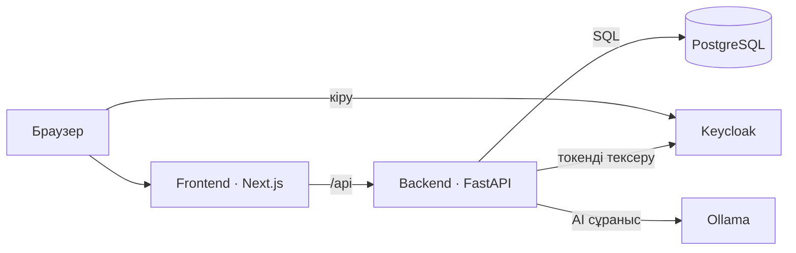

# Архитектура (6-сабақ)

QuizAI — мұғалімдерге арналған AI тест генераторы.

## Компоненттер

| Компонент | Не істейді | Сабақ |
|---|---|---|
| **Frontend · Next.js** | Пайдаланушы интерфейсі: мұғалімдер мен студенттерге арналған веб-беттер | 14 |
| **Backend · FastAPI** | REST API, қабатты архитектура, бизнес-ережелер және рөлдерді тексеру | 7–9 |
| **PostgreSQL** | Реляциялық дерекқор: кестелер, қатынастар, нәтижелер | 8 |
| **Keycloak** | OIDC сәйкестендіру жүйесі: тіркелу, кіру, рөлдер (`student`, `teacher`, `admin`), токенді тексеру | 10 |
| **Ollama · жергілікті LLM** | Промпт пен тақырып бойынша тест сұрақтарын жергілікті генерациялау қызметі | 13–14 |
