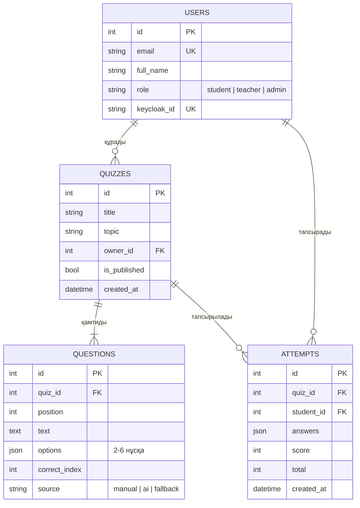

# Деректер моделі (6-сабақ)

## Кестелер
- **users:** `id` (PK), `email` (UK), `full_name`, `role` (student | teacher | admin), `keycloak_id` (UK)
- **quizzes:** `id` (PK), `title`, `topic`, `owner_id` (FK -> users.id), `is_published`, `created_at`
- **questions:** `id` (PK), `quiz_id` (FK -> quizzes.id), `position`, `text`, `options` (JSON, 2–6 нұсқа), `correct_index`, `source` (manual | ai | fallback)
- **attempts:** `id` (PK), `quiz_id` (FK -> quizzes.id), `student_id` (FK -> users.id), `answers` (JSON), `score`, `total`, `created_at`

> **Қауіпсіздік ережесі:** `users` кестесінде құпиясөз жоқ: кіру және тіркелу толық Keycloak-та орындалады.

---

## Байланыстар
- **users 1 — көп quizzes:** бір мұғалім көп тест құрайды (`quizzes.owner_id` -> `users.id`)
- **quizzes 1 — көп questions:** бір тест көп сұрақтан тұрады (`questions.quiz_id` -> `quizzes.id`)
- **users 1 — көп attempts:** бір студент көп рет тест тапсырады (`attempts.student_id` -> `users.id`)
- **quizzes 1 — көп attempts:** бір тестті көп студент тапсырады (`attempts.quiz_id` -> `quizzes.id`)
- **Көп — көп байланыс:** `users` (студенттер) мен `quizzes` (тесттер) арасындағы байланысты `attempts` аралық кестесі шешеді.

---

## ER диаграммасы

