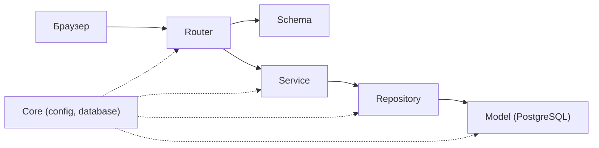

# Қабат картасы (4-сабақ)

| Қабат | 1-әрекет: Дерек құру (Товар қосу) | 2-әрекет: Басқа рөл (Тапсырыс статусын өңдеу) |
|---|---|---|
| Router | `POST /api/products` сұранысын қабылдап, кіріс деректерін Schema арқылы Service-ке бағыттайды | `PATCH /api/orders/{id}/status` маршрутында `Depends(require_role("manager"))` арқылы құқықты тексеріп, Service-ті шақырады |
| Schema | `ProductCreate` кіріс деректер пішімін/типін валидациялайды, `ProductResponse` шығыс DTO құрылымын анықтайды | `OrderStatusUpdate` кіріс мәліметтерін тексереді, `OrderResponse` шығыс жауап пішімін анықтайды |
| Service | Тауар атауының бірегейлігін тексереді және бизнес-логиканы орындайды (бағаның оң мәні Schema-да тексеріледі) | Тапсырыстың бар-жоғын тексеріп, рұқсат етілген статус ауысуын тексереді; табылмаса `EntityNotFoundError` көтереді |
| Repository | `ProductRepository.create_product` әдісі арқылы жаңа тауарды дерекқорға жазады (тек SQLAlchemy) | `OrderRepository.update_status` әдісі арқылы тапсырыс статусын дерекқорда жаңартады (тек SQLAlchemy) |
| Model | `Product` ORM моделі: `products` кестесінің құрылымын (`name`, `price`, `stock`) сипаттайды | `Order` ORM моделі: `orders` кестесінің құрылымын (`status`, `updated_at`) сипаттайды |
| Қате->HTTP | Тауар атауы бұрыннан бар болса, Service `ProductAlreadyExistsError` көтереді, ал Router/Handler оны `409 Conflict` қайтарады | Құқық жеткіліксіз болса, `Depends(require_role(...))` автоматты түрде `403 Forbidden` қайтарады |

## QuizAI қабат картасы (Жобалық үлгі)

| Қабат | 1-әрекет: Мұғалім тест құруы (`teacher`) | 2-әрекет: Студент тест тапсыруы (`student`) |
|---|---|---|
| Router | `POST /api/quizzes` маршруты, `Depends(require_role("teacher"))` арқылы рөлді тексеріп, QuizService-ті шақырады | `POST /api/quizzes/{id}/submit` маршруты, `Depends(require_role("student"))` арқылы рөлді тексеріп, SubmissionService-ті шақырады |
| Schema | `QuizCreateSchema` кіріс сұрақтар пішінін тексереді; `QuizDetailSchema` қайтарады | `QuizAnswerSubmitSchema` жауаптарды тексереді; шығыс `StudentQuizResultSchema`-да `correct_index` жасырылады |
| Service | `QuizService`: тест атауы мен сұрақтарының дұрыстығын тексереді, сұрақтар бойынша бизнес-логиканы орындайды | `SubmissionService`: тапсырылған жауаптарды тексеріп, ұпай санайды; табылмаса `QuizNotFoundError` көтереді |
| Repository | `QuizRepository.create_quiz_with_questions`: тест пен сұрақтарды байланыстырып базаға сақтайды | `SubmissionRepository.save_result`: студенттің нәтижесін `quiz_submissions` кестесіне жазады |
| Model | `Quiz` және `Question` SQLAlchemy модельдері (`title`, `description`, `questions` relations) | `QuizSubmission` SQLAlchemy моделі (`student_id`, `quiz_id`, `score`, `submitted_at`) |
| Қате->HTTP | Мұғалім рөлі болмаса `403 Forbidden`; тест параметрлері қате болса Service қатесі `400/422`-ге айналады | Тест жабылған немесе табылмаса Service `QuizNotFoundError` лақтырады, Handler оны `404 Not Found` етеді |

## Біздің ереже
- Router-де SQL жоқ, бизнес-ереже жоқ. Рөлді `Depends(require_role(...))` арқылы тексереді
- Service-те `HTTPException` жоқ (`services/errors.py` қателерін көтереді)
- Repository-де тек SQLAlchemy сұраулары
- Schema-да кіріс/шығыс деректер пішіні тексеріледі
- Model тек кесте сұлбасын анықтайды
- Құпиялар тек .env-те 